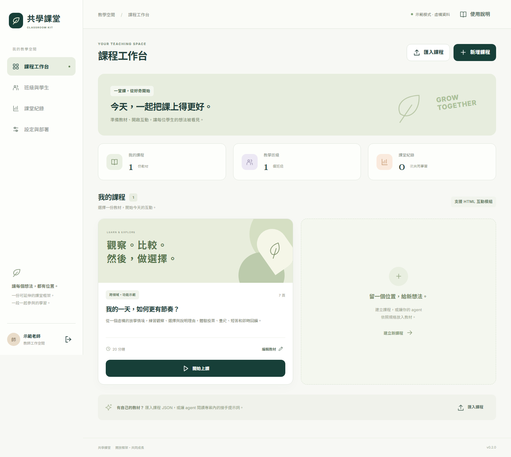

# 共學課堂 Classroom Kit

給各科教師與 AI Agent 的互動教學模板。**Cloudflare Workers 放前端及 API，D1 保存課堂、作答與小型附件。** 每位部署者使用自己的 Cloudflare 帳號與資料庫；核心功能不需要 AI 金鑰。



*本機示範畫面；教材、班級與學生資料均為虛構。*

由 [Health Classroom Kit](https://github.com/mathruffian-dot/health-classroom-kit) 延伸，保留 MIT 授權。新版把學科內容與教學框架分開，讓數學、語文、自然、社會與其他科目共用。

## 五分鐘本機體驗

需要 Node.js 24 與 npm，在專案目錄執行：

```sh
npm ci
npm run dev
```

開啟 http://127.0.0.1:8787 。啟動腳本會建立本機 D1 表、建置前端並啟動示範模式。選「教師示範」；用另一個瀏覽器或無痕視窗選學生，以班級 `DEMO801`、座號 `1` 加入，**預設不需要個人識別碼**。示範班提供 1–40 號；資料皆為虛構。本機 D1 保存在 `.wrangler/`，不會同步至雲端。

## 框架功能

- 教師工作台、班級入口 QR Code、學生平板介面、大屏授課。
- 課程 JSON 編輯、匯入／匯出、上課當時的教材快照。
- 單選、多選、量尺、短答、隔離的自訂 HTML 互動。
- 白板、雷射、聚光燈、不重複抽籤、後端決定搶答勝出者。
- 作答保存、重送去重、JSON／CSV 匯出、課堂備份與還原。
- 學生小型附件存入 D1；教師可下載自己課堂的附件。
- 選用的教師 AI 檢視／摘要；未設定時明確顯示模擬模式。

## 學生個人識別碼：預設關閉

`wrangler.jsonc` 的 `STUDENT_CODES_ENABLED` 預設為字串 `"false"`：不產生個人登入碼、不顯示輸入欄，學生以班級代碼＋座號加入。系統仍以班級與座號的內部 ID 關聯作答。

這種簡易加入方式不能防止知道班級代碼的人冒用座號。需要較可靠的身分辨識時，部署者可改為 `"true"` 再部署；新班級會產生每座號的隨機 10 字元識別碼，教師下載並個別分發。後端只保存 HMAC 驗證值，支援重發並撤銷舊登入。啟用前已建立的班級，須由教師逐座號重發；開關改變後學生須重新登入。

## 學生附件與 Cloudflare 空間

教師準備的公開圖片、教材可隨前端一起部署。**靜態資產空間不能直接接收學生上傳；學生附件透過 Worker 儲存為 D1 BLOB。**

預設限制：單檔 1 MiB、每座號每場次 10 件、每個 `APP_INSTANCE` 附件總量 100 MiB。接受 PNG、JPEG、WebP、PDF、UTF-8 純文字；需要下載時才讀取內容。學生只能存取自己座號的附件，教師可管理自己場次的附件。附件不包含在課堂 JSON 備份中；刪除場次前先下載附件。

## 部署到自己的 Cloudflare

詳見 [部署指南](docs/DEPLOYMENT.md) 與 [可貼給 Agent 的提示詞](docs/AGENT-PROMPTS.md)。正式設定預設 `APP_MODE=d1`，只有 `DB` 一個 D1 binding；不需要其他資料庫或物件儲存服務。

1. 登入 Cloudflare，建立本專案專用 D1。
2. 將實際 `database_id` 填入 `wrangler.jsonc`；模板的全零值僅供本機使用。
3. 設定 `TEACHER_PASSWORD`、`SESSION_SECRET` 兩個 Worker Secrets。
4. 執行 `npm run deploy`，套用遠端 migration 並部署至免費 `workers.dev` 網址。
5. 在正式網址驗證教師登入、學生作答、重整後讀回，以及附件下載。

每份部署使用一個教師管理密碼，適合單一教師或共同管理同一份課堂的團隊，不提供各教師獨立帳號與跨校租戶管理。不能把管理密碼交給學生。

## 免費額度與限制

使用 Workers Free 與 D1 Free，不會由程式自動升級方案。平台限制以 [Workers](https://developers.cloudflare.com/workers/platform/pricing/) 與 [D1](https://developers.cloudflare.com/d1/platform/limits/) 官方文件為準；截至 2026-10-31，D1 Free 每資料庫 500 MB、每帳號最多 10 個資料庫與總計 5 GB，還有每日讀寫上限。

預設每 10 秒輪詢；可調整 `POLL_INTERVAL_MS`，最短 5 秒。40 位學生與 1 個教師畫面每小時僅輪詢約 14,760 次請求，另需計入其他操作。免費用量由帳號內服務共同消耗，不能保證所有班級規模都符合額度。

本版課堂資料的應用層上限仍為 8 MiB，附件另外計算；不是無限容量的全校平台。上課前確認資料量、保留期限與備份。

## 教材與開發

修改 `content/` 的 JSON 或從教師端匯入自己的課程；`subject` 可填任何科目。範例另有數學與英語 JSON。格式見 [教材指南](docs/AUTHORING.md)，擴充見 [HTML bridge](docs/HTML-BRIDGE.md)。

```sh
npm run check
npx playwright install chromium
npm run test:e2e
```

[驗收紀錄](docs/VALIDATION.md) 區分本機、雲端與實機驗證；[AGENTS.md](AGENTS.md) 提供維護規則。程式及原創虛構範例採 [MIT](LICENSE)；部署者自行確認加入素材的授權，公開 repo 不放真實學生資料、識別碼或密鑰。
