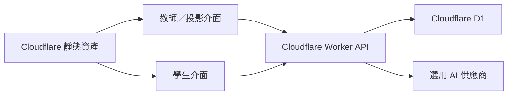

# 架構、資料與 API

`src/` 使用 Vite 與 TypeScript；`shared/`、`schemas/` 定義教材契約。`worker/app.ts` 驗證課堂操作與身分；`security.ts` 處理 HMAC、密碼驗證與來源保護；`storage.ts` 將資料分項保存至 D1；`files.ts` 管理小型附件。前端不持有任何雲端管理憑證。

## D1 模型

`migrations/0001_classroom.sql` 建立：

- `kit_meta`：instance 版本與原子更新標記。
- `kit_lessons`、`kit_classes`、`kit_students`：教材、班級及座號的識別碼驗證值。
- `kit_sessions`：場次與教材快照；`kit_answers`：逐筆作答，具有提交唯一索引。
- `kit_whiteboard`：逐筆筆跡；`kit_logins`：登入狀態；`kit_ai_usage`：每日 AI 次數。
- `kit_login_limits`：限速計數；`kit_files`：附件 metadata 與 BLOB，場次刪除時連動刪除。

課程、場次與作答以版本 1 的既有型別表示，儲存時拆為多列，避免把整站資料放進單一 D1 欄位。各資料列的 payload 是 JSON，作答透過 parent_id 關聯場次，便於 SQL 查詢。

D1 batch 交易先比對 revision，再以專屬 write token 保護同一批更新；版本衝突不覆寫其他人的資料。Worker 自動重讀並有限次重試。isolate 記憶體快取只減少未變更資料的重讀，D1 仍是唯一權威；不依賴記憶體持久性。

## 身分與流程

每份部署只有一個教師管理身分，由 TEACHER_PASSWORD Secret 驗證；登入 cookie 使用 SESSION_SECRET 簽署、HttpOnly、SameSite=Strict，HTTPS 時加 Secure。教師最長登入 1 小時，學生 4 小時；教師密碼或學生識別碼政策改變後，相關舊登入失效。

學生以班級＋座號加入；個人識別碼預設不生成。啟用後使用隨機 10 字元與 HMAC-SHA256 驗證值，重發撤銷該座號舊登入。關閉時無法防止座號冒用，只有班級／座號範圍的資料分流。

開課保存教材快照，之後改課不改舊場次。學生提交帶 submissionId，重送只保存一次。後端決定搶答贏家，輪詢速度不作為排序依據。未揭露的正解、解析及教師備註由後端移除。

## API

所有寫入使用同源 JSON、簽名 cookie 與後端權限檢查。

| 路徑 | 用途 |
| --- | --- |
| GET /api/config、/api/me | 公開設定與目前使用者，不回傳秘密 |
| POST /api/login、/api/logout | 登入／登出 |
| GET /api/dashboard | 教師工作台 |
| PUT、DELETE /api/lessons/:id | 教師教材保存／刪除 |
| POST /api/classes | 建班；只有啟用識別碼時回傳個人碼 |
| POST /api/classes/:id/credentials | 教師重發指定座號識別碼 |
| POST /api/sessions | 開課 |
| GET /api/student/session、/api/sessions/:id | 依角色過濾的場次與答案 |
| POST /api/sessions/:id/control、/answers、/buzz | 控場、作答、搶答 |
| PUT /api/sessions/:id/whiteboard | 教師筆跡 |
| GET /api/sessions/:id/export | 作答 JSON 或 CSV |
| GET、POST /api/sessions/:id/files | 權限過濾的附件清單／學生上傳 |
| GET、DELETE /api/files/:id | 下載／刪除自己的附件，或教師管理場次附件 |
| GET /api/backup、POST /api/restore | 課堂資料備份／合併還原，排除附件與登入憑證 |
| POST /api/ai | 選用的教師 AI 檢視與去識別摘要 |

## 限制

每 10 秒同步，可設定 5–60 秒。一般 JSON 請求 1 MiB；附件 Base64 請求放寬至約 1.41 MB，但解碼後檔案必須小於等於 1 MiB。還原 9 MiB 以內，先驗證教師。課堂資料總量上限 8 MiB，單項教材／場次列須小於 1.8 MB；附件另外計算。

本版為小型課堂模板，沒有跨校多租戶、獨立教師帳號、任意大檔案或影音平台。同步是輪詢，不是 WebSocket／原生 Realtime。真實負載、裝置與雲端用量須另外驗證。
